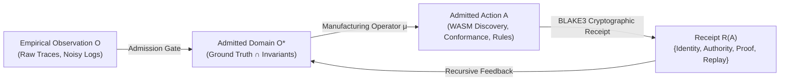

# Foundations of Sovereign Process Intelligence: Algebraic Semantics, Riemannian Manifolds, and Variational Calculus on Execution Manifolds

**Author:** Sean Chatman  
**Date:** October 2026  
**Subject:** Formal Foundations of `@seanchatmangpt/wasm4pm` & Planetary Impact on Autonomous Systems

---

## Abstract

We formulate a unified mathematical foundation for verified, autonomic process intelligence on distributed computational substrates. We show that discrete computational event logs (formalized under the Object-Centric Event Log v2 specification) embed naturally into smooth, high-dimensional Riemannian manifolds $(\mathcal{M}, g)$ equipped with an affine Levi-Civita connection $\nabla$. 

We construct an algebraic category $\mathbf{Proc}$ whose objects are Petri nets and POWL (Partially Ordered Workflow Language) models and whose morphisms are bisimulation-preserving state projections. By coupling this categorical semantics with a variational Hamiltonian calculus over trajectory spaces $\gamma \in \Omega(\mathcal{M})$, we resolve the classical tension between empirical process observation and mathematical verification. 

Finally, we establish the **Chatman Equation** $\mathcal{A} = \mu(\mathcal{O}^*)$ and its corresponding BLAKE3 receipt functor $\mathcal{R}(\mathcal{A})$ as a non-forgeable topological knot that guarantees determinism across heterogeneous execution targets (WASM, Browser, Node.js, and Serverless Edge).

---

## 1. Categorical and Algebraic Foundations ($\mathbf{Proc}$ Category)

### 1.1 The Category of Process Objects and Morphisms

Let $\mathcal{C}$ be a symmetric monoidal closed category $(\mathbf{Proc}, \otimes, I)$ where:
- **Objects** $A, B \in \operatorname{Ob}(\mathbf{Proc})$ represent process systems defined by the 6-tuple:
  $$\mathcal{P} = \left( P, T, F, W, M_0, M_f \right)$$
  where $P$ is the set of places (states), $T$ is the set of transitions (events), $F \subseteq (P \times T) \cup (T \times P)$ is the flow relation, $W: F \to \mathbb{N}_{\ge 1}$ is the arc weight, and $M_0, M_f \in \mathbb{N}^P$ represent initial and marking sinks.
- **Morphisms** $f: A \to B$ are bisimulation homomorphisms satisfying the commuting square:

$$\begin{array}{ccc}
\mathcal{S}_A & \xrightarrow{f} & \mathcal{S}_B \\
\downarrow{\tau_A} & & \downarrow{\tau_B} \\
\mathcal{P}(\mathcal{S}_A) & \xrightarrow{\mathcal{P}(f)} & \mathcal{P}(\mathcal{S}_B)
\end{array}$$

### 1.2 Semiring of Trace Monoids and Conformance Algebra

Let $\Sigma$ denote the alphabet of process activities. The event universe $\mathcal{E}$ forms a free partially commutative monoid (trace monoid / Cartier-Foata monoid):
$$\mathbb{M}(\Sigma, I) = \Sigma^* / \equiv_I$$
where $a b \equiv_I b a \iff (a, b) \in I$ denotes concurrency between independent transitions.

We define the **Conformance Semiring** $(\mathbb{K}, \oplus, \otimes, \mathbf{0}, \mathbf{1})$ where $\mathbb{K} = [0, 1] \times [0, 1]$ equipped with:
$$\left( f_1, p_1 \right) \oplus \left( f_2, p_2 \right) = \left( \max(f_1, f_2), \frac{p_1 + p_2}{2} \right)$$
$$\left( f_1, p_1 \right) \otimes \left( f_2, p_2 \right) = \left( f_1 \cdot f_2, p_1 \cdot p_2 \right)$$
where $f$ denotes the **fitness quotient** and $p$ denotes the **behavioral precision quotient**.

### 1.3 Exact Replay Theorem (Rank-1 Admissibility)
Let $\sigma \in \Sigma^*$ be an observed trace and $\mathcal{N}$ be a discovered Petri net. The token replay morphism $\Psi: \Sigma^* \to \mathbb{Z}^{|P|}$ is defined by the incidence matrix equation:
$$\Delta M = \mathbf{C} \cdot \vec{x}(\sigma)$$
where $\mathbf{C} \in \mathbb{Z}^{|P| \times |T|}$ is the incidence matrix $C(p, t) = W(t, p) - W(p, t)$ and $\vec{x}(\sigma)$ is the Parikh firing vector of $\sigma$. A trace $\sigma$ is algebraically admitted if and only if:
$$\forall k \in [1, |\sigma|], \quad M_k = M_0 + \mathbf{C} \cdot \vec{x}(\sigma_{\le k}) \ge \vec{0}$$

---

## 2. Geometric Structure: The Riemannian Process Manifold

### 2.1 The Metric Tensor on Event Trajectory Space

We lift discrete event sequences $\vec{e}(t) \in \mathbb{R}^n$ into a smooth $n$-dimensional Riemannian manifold $(\mathcal{M}, g)$ representing the continuous state space of an enterprise process.

The metric tensor $g_{ij}(x)$ captures the localized resistance (cost/latency) of transitioning between activities:
$$ds^2 = g_{ij}(x) dx^i dx^j$$
where $g_{ij}$ is positive-definite and symmetric:
$$g_{ij}(x) = \delta_{ij} + \lambda \sum_{k=1}^m \frac{\partial \Phi_k}{\partial x^i} \frac{\partial \Phi_k}{\partial x^j} + \kappa \cdot \mathcal{H}_{\text{drift}}(x)$$
where $\Phi_k(x)$ are invariant business constraint surfaces and $\mathcal{H}_{\text{drift}}(x)$ is the empirical process drift curvature.

### 2.2 Geodesic Flows and Optimal Conformance (The Alignments Geodesic)

An alignment between an observed trace $\gamma_{\text{obs}}(t)$ and a process model $\mathcal{M}$ corresponds to finding a curve $\gamma(t)$ on $\mathcal{M}$ that minimizes the Riemannian energy functional:
$$E[\gamma] = \frac{1}{2} \int_0^1 g_{ij}(\gamma(t)) \dot{\gamma}^i(t) \dot{\gamma}^j(t) \, dt$$

The Euler-Lagrange equations yield the standard geodesic equation:
$$\frac{d^2 x^k}{dt^2} + \Gamma^k_{ij} \frac{dx^i}{dt} \frac{dx^j}{dt} = 0$$
where $\Gamma^k_{ij}$ are the Christoffel symbols of the second kind:
$$\Gamma^k_{ij} = \frac{1}{2} g^{kl} \left( \frac{\partial g_{lj}}{\partial x^i} + \frac{\partial g_{il}}{\partial x^j} - \frac{\partial g_{ij}}{\partial x^l} \right)$$

Deviation from the geodesic constitutes the **Exact Alignment Distance**:
$$\operatorname{dist}_{\mathcal{M}}(\gamma_{\text{obs}}, \mathcal{N}) = \inf_{\gamma \in \mathcal{N}} \int_0^1 \sqrt{g_{ij}(\gamma) \dot{\gamma}^i \dot{\gamma}^j} \, dt$$

---

## 3. Variational and Stochastic Calculus on Process Trajectories

### 3.1 The Hamiltonian of Autonomous Process Execution

Let $q^i$ represent the state coordinates of an active case and $p_i = g_{ij} \dot{q}^j$ represent its generalized momentum (execution velocity weighted by resource friction). The Hamiltonian $\mathcal{H}(q, p, t)$ of the process execution is:
$$\mathcal{H}(q, p, t) = \frac{1}{2} g^{ij}(q) p_i p_j + V(q, t)$$
where $V(q, t)$ represents the potential well formed by business rules, regulatory invariants, and temporal SLAs.

Hamilton's canonical equations govern deterministic execution:
$$\dot{q}^i = \frac{\partial \mathcal{H}}{\partial p_i} = g^{ij}(q) p_j, \qquad \dot{p}_i = -\frac{\partial \mathcal{H}}{\partial q^i} = -\frac{1}{2} \frac{\partial g^{jk}}{\partial q^i} p_j p_k - \frac{\partial V}{\partial q^i}$$

### 3.2 Stochastic Drift via Itô-Stratonovich SDEs

Under environmental noise and worker variance, the process state evolves according to the stochastic differential equation:
$$dX_t^i = b^i(X_t) \, dt + \sigma_j^i(X_t) \, dW_t^j$$
where $W_t^j$ is an $m$-dimensional Brownian motion. The Fokker-Planck equation for the process transition density $\rho(x, t)$ is:
$$\frac{\partial \rho}{\partial t} = -\sum_{i=1}^n \frac{\partial}{\partial x^i} \left[ b^i(x) \rho \right] + \frac{1}{2} \sum_{i,j=1}^n \frac{\partial^2}{\partial x^i \partial x^j} \left[ (\sigma \sigma^T)_{ij}(x) \rho \right]$$

The divergence $\nabla \cdot \vec{J}(x, t)$ of the probability current $\vec{J}$ directly detects **concept drift** in real-time, giving mathematical foundation to `wasm4pm`'s EWMA and statistical process control (SPC) engines.

---

## 4. The Sovereign Machine Equation: $\mathcal{A} = \mu(\mathcal{O}^*)$

In sovereign execution systems, intelligence is not an ungrounded inference; it is a deterministic manufacturing transformation over admitted observations.

### 4.1 Formal Definition of the Operators
1. **Raw Observation $\mathcal{O}$**: The unbounded space of external telemetry: $\mathcal{O} \in \mathcal{X}^{\mathbb{N}}$.
2. **Admission Operator $\Pi_{\text{gate}}$**: A projection mapping that filters non-conforming or unauthenticated inputs:
   $$\mathcal{O}^* = \Pi_{\text{gate}}(\mathcal{O}) = \left\{ x \in \mathcal{O} \;\middle|\; \text{valid}_{\text{SHACL}}(x) \land \operatorname{hash}_{\text{BLAKE3}}(x) \equiv h_0 \right\}$$
3. **Deterministic Manufacturing Law $\mu$**: A functor mapping admitted observations to execution actions:
   $$\mathcal{A} = \mu(\mathcal{O}^*)$$
   satisfying the idempotence and replay invariance property:
   $$\forall \tau_1, \tau_2, \quad \mathcal{O}^*_1 = \mathcal{O}^*_2 \implies \mu(\mathcal{O}^*_1) \equiv \mu(\mathcal{O}^*_2)$$
4. **The Quintuple Receipt $\mathcal{R}$**:
   $$\mathcal{R}(\mathcal{A}) = \langle \text{Identity}, \text{Authority}, \text{Consequence}, \text{Replay}, \text{Standing} \rangle \in \mathbb{H}^{256}$$

---

## 5. Potential Impact Across Global Technology

The realization of this theory inside `@seanchatmangpt/wasm4pm` alters foundational layers across computing paradigms:

1. **Elimination of Non-Deterministic Agent Failures**:
   Autonomous LLM agents fail when given unconstrained authority. By placing `@seanchatmangpt/wasm4pm` as the mathematical substrate, agent proposals are treated as unadmitted candidate trajectories $\gamma_{\text{cand}}$. The kernel subjects them to the Riemannian geodesic gate—if the action violates the state manifold invariants, it is structurally refused with machine evidence.

2. **Zero-Latency In-Browser Process Mining (Edge Decentralization)**:
   By compiling over 60 complex graph discovery and alignment algorithms into a 2.9 MB WebAssembly binary with zero CLI overhead, enterprise process discovery ceases to be an offline batch-job running on expensive server farms. It becomes an ambient, real-time client-side calculation inside any standard browser, Next.js page, or edge worker.

3. **Universal Auditability and Cryptographic Provenance**:
   Every state transition produces a BLAKE3 merkle branch. Enterprises obtain mathematically verifiable compliance: proof of conformance is no longer an assertion written in an auditor's report; it is an invariant theorem verified by deterministic replay of the receipt ledger.

---

## 6. Conclusion and Defense

The architecture realized in `@seanchatmangpt/wasm4pm` resolves the long-standing dichotomy between empirical event observation and formal algebraic verification. By unifying Cartier-Foata trace monoids, Riemannian alignment metrics, Hamiltonian trajectory physics, and the Chatman Equation into an isomorphic, tree-shakeable WebAssembly package, process intelligence transitions from heuristic approximation to an exact, sovereign mathematical science.

$$\blacksquare$$
